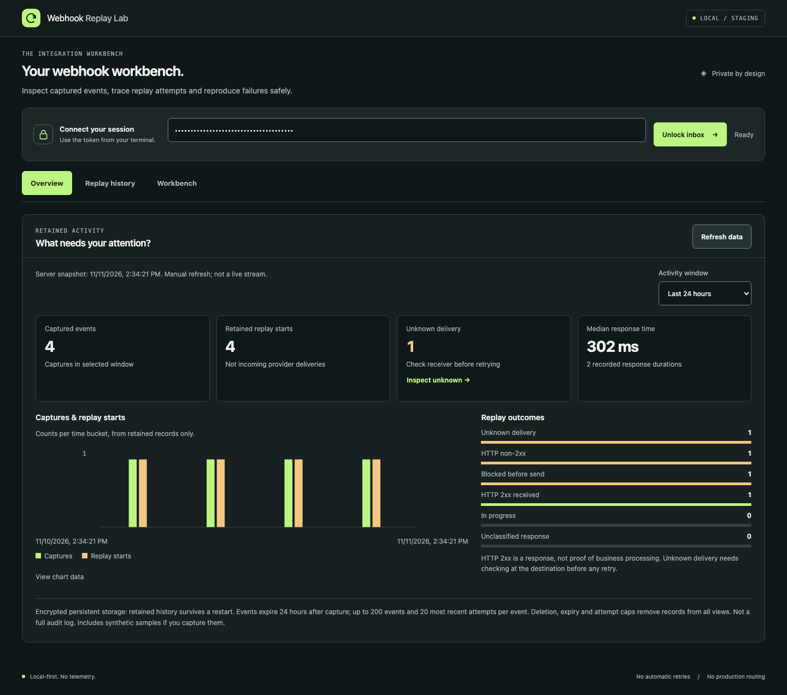
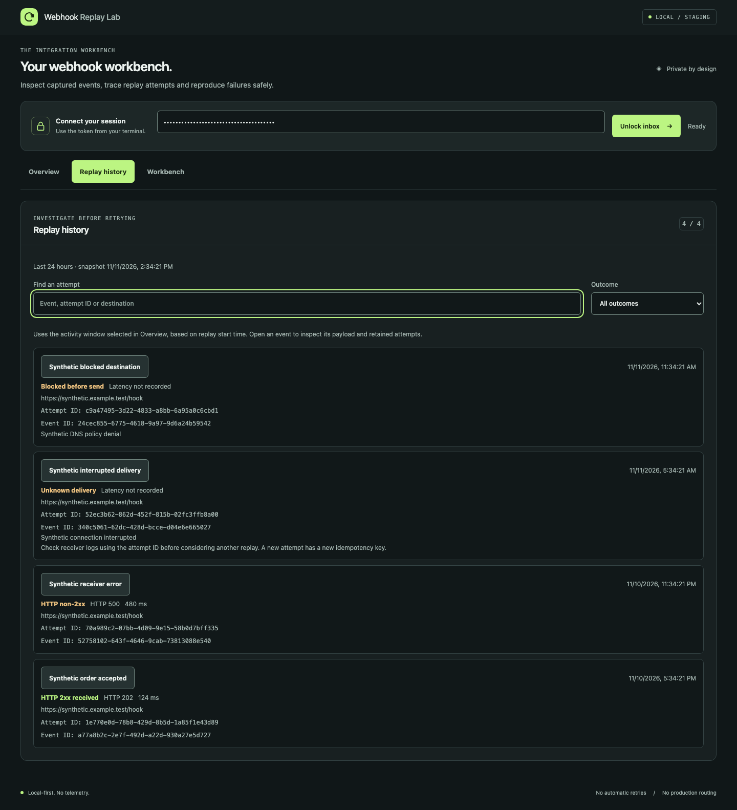
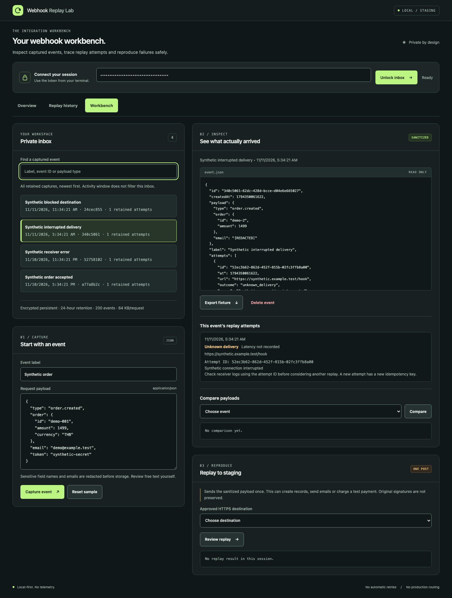
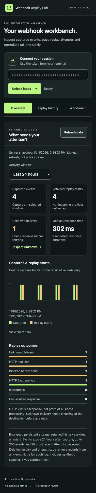

# Webhook Replay Lab

A dependency-free, local-first staging debugger: capture JSON, sanitize it, export a reproducible fixture, compare payloads, and explicitly replay once to an approved staging endpoint.

**Status: v0.3.0 stable private developer tool.** Capture, sanitized export/comparison, explicit one-shot HTTPS replay and encrypted persistence are implemented and locally verified, including real TLS transport and isolated Docker backup restoration. This is not a public webhook delivery gateway. Deployment on an actual Hostinger VPS and public ingress routing remain unverified. See [self-hosting, backup and recovery](docs/SELF_HOSTING.md).

## Screenshots

Three focused views: Overview, Replay history, and Workbench. Screenshots use actual locally recorded **synthetic** captures and injected replay outcomes, not customer traffic or an external staging integration. No real customer data or usable credentials are shown. Charts in normal use derive only from retained server records; the app does not seed demo metrics.



<details>
<summary>Replay history and selected-event investigation</summary>





</details>

<details>
<summary>Mobile layout (390 px)</summary>



</details>

## Start

Requires Node.js 22 or newer (container: Node 24; local verification: Node 25.2.1).

```sh
npm start
```

Open http://127.0.0.1:4319 and paste the session token printed in your terminal. No dependency installation required. Do not share this token or redirect logs to a shared location. The token is generated per process unless `LAB_TOKEN` is supplied. Keep the terminal running; Ctrl-C stops the lab and discards its memory.

1. Unlock the inbox and open **Workbench**.
2. Capture the clearly labeled synthetic order.
3. Inspect the redacted JSON and export its fixture.
4. Change the synthetic amount, capture a second event, then compare it with the first.
5. Delete events you no longer need.

Default storage is **memory-only** (the self-hosted profiles use encrypted snapshots): restart loses all events, confirmations and attempt records. Export needed fixtures. Expired events are inaccessible after 24 hours and swept from memory at most 30 seconds later. Exported files are outside this retention policy; delete them yourself. No raw request headers are retained.

## Investigate with real retained data

- **Overview:** last-hour or last-24-hour capture/replay-start counts, 12 time buckets, outcome distribution, unknown deliveries, and median recorded HTTP-response latency. Open the accessible chart table for exact timestamps and counts. Every figure uses the server snapshot time; **Refresh data** is manual, not a live stream.
- **Replay history:** search event labels/IDs, attempt IDs, and destinations; filter unknown, non-2xx, blocked, 2xx, or active outcomes. It uses replay start time, independent of the original capture time. The initial list shows 20 attempts with a Show more control. Open any result directly in Workbench.
- **Workbench:** searchable capture inbox, redacted JSON, fixture export, payload comparison, and this event's newest-first attempt timeline. History includes target, time, HTTP code, recorded latency, error and correlation ID when available. Only explicitly confirmed replay can send a request.
- **Honest outcomes:** HTTP 2xx means a response was received, not that business processing succeeded. A timeout/interrupted transport can be **unknown delivery**, not a safe-to-retry failure. Review receiver logs with its attempt ID first. Missing latency is shown as unavailable, not zero.
- **Persistence:** no new history database is required. Existing optional encrypted snapshots preserve records across restart; default memory-only mode does not. Events expire 24 hours after capture, with at most 200 events and 20 retained attempts per event. Deletion, expiry and caps remove records from counts. This is **not a complete audit log**. Synthetic samples you capture count as real records in this workspace and remain visibly labeled.

Tab navigation supports keyboard arrows, Home/End, and view-only URL hashes with Back/Forward. Tokens and payloads are never saved to browser storage or the URL. A failed refresh clearly marks the older snapshot.

See [dashboard design, verification and bounded performance measurements](docs/DASHBOARD.md) for scope and remaining gaps.

## Optional staging replay

Only enable an endpoint that you own and have confirmed is isolated staging with harmless test credentials and test downstream integrations. The program cannot prove an environment is staging. An allowlisted production URL would still be dangerous.

```sh
STAGING_ALLOWLIST='https://your-confirmed-staging.example/webhooks/test' npm start
```

Comma-separated exact HTTPS URLs are accepted. No query strings, fragments, URL credentials, IP literals, or ports other than 443. Do not put secrets in URL paths. Each replay requires reviewing the destination and payload hash and typing `SEND TO STAGING`; confirmation expires after 60 seconds and is consumed before network activity. There are no automatic retries. Inspect an unknown-delivery result at the destination before considering another attempt.

All DNS answers must be public IPv4. Dual-stack hostnames are rejected when the resolver returns IPv6 answers. The validated address is pinned to the TLS connection while the original hostname remains the certificate/SNI authority. IPv6 and special/private/metadata addresses fail closed. Redirects are reported but never followed. DNS has a two-second deadline; the request has a five-second transport deadline and a 64 KB response limit; response bodies and headers are not stored. Each replay attempt ID is persisted before sending and transmitted as both `Idempotency-Key` and `X-Webhook-Replay-Attempt`. Use that ID to find an uncertain attempt in receiver logs. A new attempt gets a new key; receiver support is unknown and this is **not** a guarantee against duplicate effects.

Replay sends only sanitized JSON and newly generated minimal headers. It does not forward authentication, cookies or original provider signatures. This may intentionally break a provider-specific signature check. Use a dedicated staging adapter; do not disable verification on a production endpoint.

## Private capture API

The inbox is not a publicly accessible provider URL. A local integration test may submit JSON with the same session token:

```sh
curl http://127.0.0.1:4319/api/events \
  -H "Authorization: Bearer $LAB_TOKEN" \
  -H 'Content-Type: application/json' \
  --data '{"label":"Synthetic test","payload":{"type":"test.event","value":1}}'
```

For this example, start the server with `LAB_TOKEN` set to your own randomly generated value of at least 32 characters. Do not use a real customer payload before reviewing redaction limitations.

## Container

```sh
export LAB_TOKEN="$(openssl rand -hex 32)"
docker compose up --build
```

Compose publishes **only 127.0.0.1:4319**, uses a non-root user, read-only filesystem, dropped capabilities and resource limits. It has no persistent volume because the inbox is deliberately ephemeral. Never change the published address to a public interface without a separate security design and authorization. A remote VPS requires SSH forwarding for the private UI. The optional ingress profile exposes only a custom signed capture route, not native provider signatures. No deployment has been performed.

## Hostinger VPS

Use the dedicated private persistent profile in [the Hostinger guide](docs/HOSTINGER.md). It keeps the UI behind SSH forwarding, disables signed ingress, and uses a Docker-managed volume containing encrypted snapshots. This is a VPS/Docker path, not PHP shared hosting or a public managed web app. Hostinger deployment and partner-program approval are **not verified**. The desktop and mobile screenshots above show the current private workbench.

## Checks

Tests require Node.js 22+ and OpenSSL on PATH (for a temporary local TLS certificate). Tests use synthetic data; the HTTPS transport tests never contact an external endpoint or weaken production destination validation.

```sh
npm test
npm run check
LAB_TOKEN=synthetic-config-validation-token-000000 docker compose config --quiet
```

Optional browser QA uses an existing Playwright installation:

```sh
PLAYWRIGHT_MODULE=/absolute/path/to/playwright/index.mjs node test/ui-smoke.mjs
PLAYWRIGHT_MODULE=/absolute/path/to/playwright/index.mjs node test/dashboard-smoke.mjs
PLAYWRIGHT_MODULE=/absolute/path/to/playwright/index.mjs node test/dashboard-performance.mjs
```

The browser test blocks all non-local requests. It covers unlocking, repeated capture clicks, sanitization, comparison, fixture download, deletion, token-change handling, mobile overflow and browser errors. The dashboard suite also checks encrypted-history restart, filters, exact metric values, retention, stale snapshots, token clearing and responsive views. Run it last to regenerate all four screenshot files in `docs/`. The separate performance script is synthetic and makes no competitor-speed claim.

## Limits and honest boundaries

- 64 KB inbound JSON and newly sanitized payloads; 200 events; 120 authenticated API requests/minute; 100 pending confirmations; 20 retained attempts/event; one replay start per five seconds.
- Redaction uses sensitive field-name matching and email/Bearer patterns. Recognized credential fields include CVV/CVC, PIN/OTP/TOTP, JWT, private keys, session IDs, account/routing numbers, IBAN, recovery/backup codes, access/signing/encryption keys and security answers, including common camelCase and separator variants. It is not DLP and cannot guarantee removal of arbitrary personal data, secrets in free text, labels or unusual schemas. Review exported fixtures and replay content manually.
- Payload comparison reports at most 200 differing paths; it is not a schema-aware or response-body regression runner. Missing values are marked separately from explicit null; own-property checks handle prototype-named fields.
- Single-user token, no tenant isolation, SSO/RBAC, scheduling or delivery queue. Optional AES-256-GCM snapshots retain bounded attempt history, not a comprehensive audit log.
- Custom signed ingress only, no native provider adapters or outbound authentication. No guarantee of exactly-once delivery.
- This is a bounded developer tool, not a hardened internet-facing security product. See [security notes](docs/SECURITY.md), [product hypothesis](docs/PRODUCT.md), and [verification](docs/VERIFICATION.md).

## License

MIT. See [development plan](PLAN.md) and [changelog](CHANGELOG.md). No service deployment is included.
